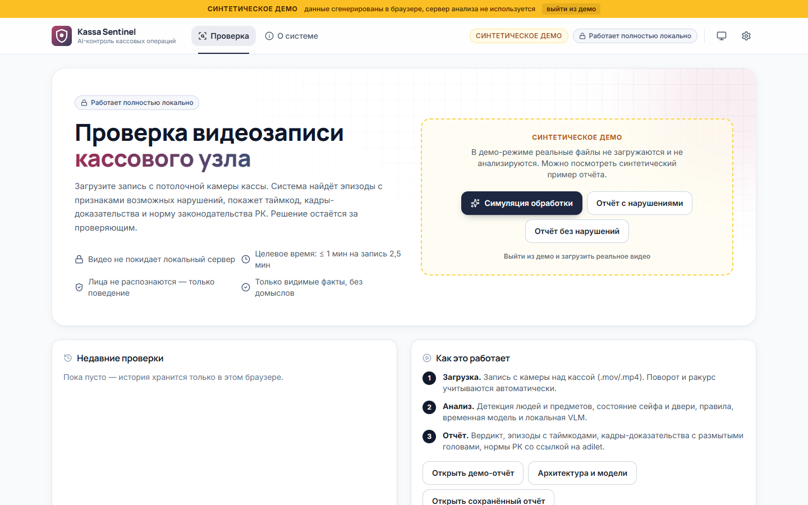
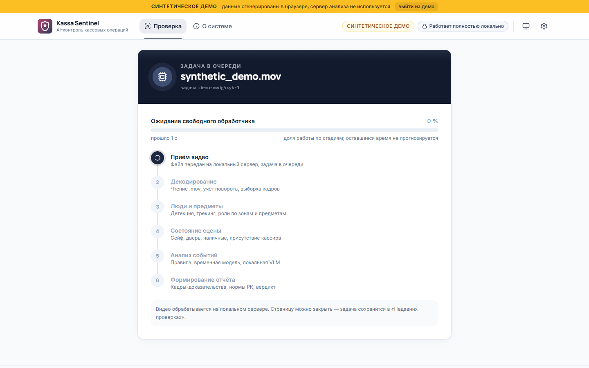
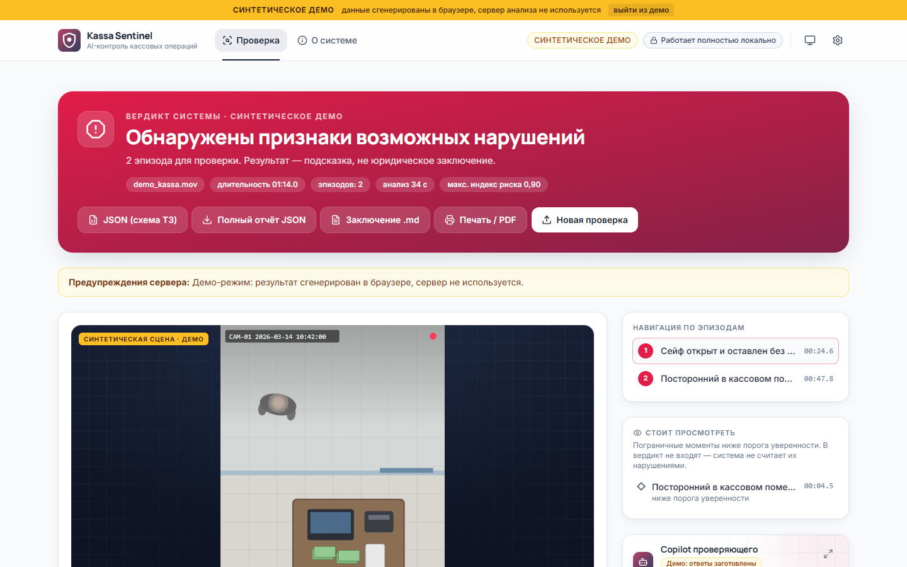
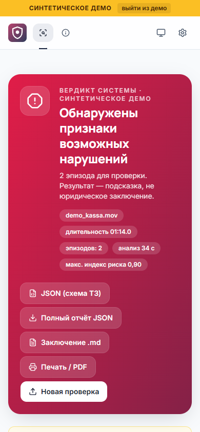

# Kassa Sentinel

**Локальный AI-ассистент проверяющего: находит на записи потолочной камеры кассы эпизоды с признаками
нарушений, показывает таймкод, кадры-доказательства и норму законодательства РК.**
Datathon ForteBank 2026 · команда «durachki».

> Видео не покидает сервер банка. Облачных AI-сервисов нет, модели только под Apache-2.0 / MIT / BSD.
> Лица не распознаются, головы на кадрах-доказательствах размыты. Результат — подсказка для человека,
> а не юридическое заключение.

| Что получает проверяющий | Как |
|---|---|
| Вердикт `violation` / `no_violation` | API строго по схеме ТЗ, плюс веб-интерфейс |
| Эпизоды: тип, таймкод (начало нарушения), описание «что видно» | от правил по времени, детектора, трекинга, позы и локальной VLM |
| 1–3 кадра-доказательства «до/после» | JPEG с реальными PTS кадров, головы размыты |
| Норма РК со ссылкой на adilet.zan.kz | цитаты проверяются по сохранённым текстам; без подтверждённого пункта — честное «без пункта» |
| Честная полнота анализа | «нарушений нет» выдаётся только при полном анализе, иначе — «нужен ручной просмотр» |

## Как это выглядит

Скриншоты синтетического демо: на реальных записях есть люди, поэтому их кадры в публичный репозиторий не попадают.

| Загрузка записи | Анализ: стадии и прогресс |
|---|---|
|  |  |

| Отчёт: вердикт, эпизоды, лента риска, кадры-доказательства | Телефон |
|---|---|
|  |  |

---

## Почему это решение

1. **Работает в контуре банка.** Весь анализ на одной ноутбучной видеокарте (RTX 4060 8 ГБ; облегчённый профиль
   с VLM 2B запускался и на RTX 4050 6 ГБ),
   рантайм без интернета (`HF_HUB_OFFLINE=1` и сетевой запрет внутри процесса). Проверено офлайн-смоуком:
   ноль попыток выхода в сеть.
2. **Объясняет, а не угадывает.** Классификатор по целому кадру здесь не работает (замер: AUC 0,30–0,34),
   потому что нарушение отличается от нормы одной деталью. Решение строится из наблюдаемых состояний:
   кто где стоит, открыт ли сейф, что в руках, что на столе. Каждое событие хранит трассу: какие кадры
   видели факт, какие были «неизвестно». Поверх видео в интерфейсе рисуются скелеты, треки, предметы и зоны.
3. **Не врёт пользователю.** «Неизвестно» ≠ «нет». Если стадия не выполнилась, интерфейс прямо говорит,
   чего система не проверила и что это значит для вывода.
4. **Учится на своих данных.** Собственная разметка 700 кадров (10 классов) и дообучение детектора
   за ~45 минут на ноутбуке: на невиданных видео mAP50 по банковским предметам вырос с 0,10 до 0,79 (см. ниже).
5. **Нормативка без фантазий.** Каталог норм НБРК строится только из сохранённых текстов, и каждая цитата
   проверяется дословно (`python -m norms.validate`).

## Как пользоваться

**Веб-интерфейс:** открыть адрес → ввести ключ → перетащить `.mov` (можно несколько) → смотреть результат:
вердикт, лента риска с эпизодами, навигация по эпизодам, кадры «до/после», норма, блок «что система не
проверяет». Отчёт выгружается в JSON (схема ТЗ), полный JSON, Markdown-заключение и PDF (печать).

**API (как в ТЗ):**

```bash
curl -X POST https://<адрес>/api/v1/analyze -H "X-API-Key: <ключ>" -F "file=@video_017.mov"
# → {"job_id": "..."}
curl https://<адрес>/api/v1/jobs/<job_id> -H "X-API-Key: <ключ>"
# → {"job_id","status","verdict","violations":[{"type","timecode_sec","description","evidence_frames":[{"timestamp_sec","image_base64"}]}]}
```

Без верного ключа — 401. Схема — [`contracts/api_schema.json`](contracts/api_schema.json), проверка ответа —
`python -m contracts.validate --jury resp.json`. Адрес, ключ и состав пакета для сдачи описаны в [`docs/SUBMISSION.md`](docs/SUBMISSION.md).

## Как запустить

**Что нужно:** Windows 10/11, NVIDIA GPU от 6 ГБ (проверено на RTX 4060 8 ГБ и 4050 6 ГБ), Python 3.11
(3.13 тоже работает), Node.js 18+, около 15 ГБ на диске под веса. Интернет нужен только один раз, чтобы скачать веса.

**1. Код и видео**

```powershell
git clone https://github.com/diiaanns07-droid/durachki_team_forte.git
cd durachki_team_forte
# видео датасета кладутся в data\raw\ (в git их нет)
```

**2. Окружение, веса, фронтенд** (один раз)

```powershell
powershell -ExecutionPolicy Bypass -File deploy\windows\setup.ps1 -InstallMissing   # .venv по lock-файлу + недостающее
.venv\Scripts\python -m ml.detect.weights --download                               # детекторы RT-DETRv2 + OWLv2
.venv\Scripts\python deploy\weights.py prepare --only "Qwen3-VL-4B-Instruct"       # VLM (6 ГБ: "Qwen3-VL-2B-Instruct")
.venv\Scripts\python deploy\weights.py adopt                                       # инвентаризация весов → lock; дальше офлайн
cd frontend; npm ci; npm run build; cd ..                                            # веб-интерфейс → frontend\dist
copy deploy\.env.example deploy\.env                                                 # ключ доступа и профиль — в deploy\.env
```

**3. Запуск**

```powershell
powershell -ExecutionPolicy Bypass -File deploy\windows\start.ps1          # прогрев → пробный анализ → API → туннель
powershell -ExecutionPolicy Bypass -File deploy\windows\start.ps1 -NoTunnel  # только локально: http://127.0.0.1:8000
```

Откройте адрес из консоли (публичный адрес пишется в `logs\public_url.txt`), введите ключ из `deploy\.env`
и перетащите `.mov`. Статус и остановка: `deploy\windows\status.ps1`, `deploy\windows\stop.ps1`.

**Профиль анализа** задаётся в `deploy\.env` через `SENTINEL_PROFILE=pose_rules_vlm01`: это лучший по замеру
профиль, все профили лежат в `deploy/profiles/`. На видеокарте с 6 ГБ нужна облегчённая VLM:
`SENTINEL_VLM_PRESET=qwen3vl2b`.

**Дообученный детектор** (сейф, деньги, сумка, дверь, счётная машинка):

```powershell
.venv\Scripts\python -m ml.detect.finetune train --coco datasets\det\annotations.json --annotator "<кто проверил>" --out runs\detect_ft
.venv\Scripts\python -m ml.detect.finetune export --model runs\detect_ft\hf --out weights\detect\finetuned
# в deploy\.env:  SENTINEL_DETECT_EXTRAS=finetuned
```

Обучение занимает около 45 минут на RTX 4050. Модуль учится только на разметке, проверенной человеком: финальная
проверка 700 кадров идёт в Label Studio, вкладка «Спорные» (см. [`datasets/det/README.md`](datasets/det/README.md)).

**Без GPU и весов** (только код, тесты и синтетическое демо): `make setup-dev && make test-fast && make e2e`, а
интерфейс — `cd frontend && npm run dev`, дальше открыть `http://localhost:5173/?demo=1`.
Подробнее — [`docs/DEVELOPERS.md`](docs/DEVELOPERS.md); Docker и Cloudflare Tunnel — [`deploy/README.md`](deploy/README.md).

## Как устроено

```
веб-интерфейс (React) ─┐
                       ├─ API (FastAPI): ключ, очередь, дедлайн, идемпотентность по sha256, честные статусы
жюри (curl) ───────────┘        │
                                └─ пайплайн, один GPU-воркер:
   ingest (реальные PTS, переменный fps) → detect (RT-DETRv2 + OWLv2 [+ дообученный детектор])
   → track (ByteTrack, роли по зонам) → pose (RTMPose, скелет на трек) → scene / seqrules (правила по времени:
   телефон у руки, сейф без присмотра, вход в зону) → VLM (Qwen3-VL: состояние сцены по кадрам, проверка кандидатов)
   → fusion (слияние, пороги, таймкод = начало эпизода, кадры-доказательства, описание, нормы)
```

| Модель | Зачем | Лицензия |
|---|---|---|
| PekingU/rtdetr_v2_r18vd | люди и предметы; основа дообученного детектора | Apache-2.0 |
| google/owlv2-base-patch16-ensemble | open-vocabulary: сейф, деньги, сумка; пред-разметка | Apache-2.0 |
| RTMPose-m (ONNX) | скелет: руки, голова, ориентация | Apache-2.0 |
| Qwen/Qwen3-VL-4B-Instruct (4-bit) | вопросы о состоянии сцены, проверка кандидатов | Apache-2.0 |
| intfloat/multilingual-e5-small | поиск по нормам для ассистента проверяющего | MIT |

Библиотеки: PyTorch (BSD), Transformers (Apache-2.0), FastAPI (MIT), React (MIT), Label Studio Community
(Apache-2.0, только для разметки).

**Типы нарушений:** V01 посторонний в кассовой зоне · V02 ценности без присмотра · V03 сейф открыт без
присмотра · V04 вход при открытых ценностях · V05 мобильный телефон при работе с ценностями · V06 еда и напитки ·
V07 нарушение передачи инкассаторской сумки · V08 пересчёт не при клиенте · V09 личные вещи · V99 иное
(только подсказка). Связь «норма → что видно → сигнал → событие» описана в [`norms/MAPPING.md`](norms/MAPPING.md).

## Данные и дообучение детектора

COCO-детекторы с потолочной камеры не видят сейф, деньги и инкассаторскую сумку: в наших 40 роликах сейф
не находился ни разу. Поэтому сделан собственный датасет — [`datasets/det/`](datasets/det/README.md):

- **кадры** — 1711 кадров из 42 роликов: шаг 1 с и 4 кадра/с около нарушений. Для разметки отобрано 700
  кадров со всех 40 уникальных роликов (без почти-дублей статичной камеры);
- **10 классов** — `cash, cash_bag, safe_closed, safe_open, cell_phone, cup, food, money_counter, door_open, person`;
  всего 3132 рамки;
- **конвейер** — пред-разметка OWLv2 → выбор и исправление рамок по листам проверки → независимый контрольный
  проход (173 спорных кадра пересмотрены) → Label Studio для финальной проверки человеком;
- **сплит train/val — по видео, а не по кадрам** (дубликаты по md5 вместе), чтобы не было утечки.

**Эксперимент с дообучением RT-DETRv2-r18** (30 эпох, около 45 минут на RTX 4050 Laptop): обучение на 31 train-видео,
оценка на 9 val-видео, которых модель не видела.

| Класс | Рамок в val | AP50 до (COCO-детектор) | AP50 после |
|---|---|---|---|
| safe_closed | 134 | 0,00 | **1,00** |
| money_counter | 138 | 0,00 | **1,00** |
| door_open | 69 | 0,00 | **0,98** |
| cash | 45 | 0,00 | **0,83** |
| cash_bag | 5 | 0,00 | 0,94 |
| safe_open | 4 | 0,00 | 0,75 |
| person | 219 | 0,78 | 0,78 |
| **mAP50** | | **0,10** | **0,79** |

Важные оговорки:
- эталон — черновая разметка: её проверял AI-ассистент, а не человек;
- съёмка из той же комнаты и с той же камеры;
- `cash_bag` и `safe_open` — единицы примеров;
- `cell_phone` пока не выучен (3 примера в val).

Поэтому боевой детектор по правилам команды учится только на разметке, проверенной человеком. Модуль
`ml.detect.finetune` сам откажется учиться на черновике. Финальная проверка в Label Studio сокращена
до 173 спорных кадров. Как подключить дообученную модель к пайплайну:
`SENTINEL_DETECT_EXTRAS=finetuned` (см. [`ml/detect/README.md`](ml/detect/README.md)).

## Качество системы сейчас (честно)

Разведочная оценка на 42 обучающих видео (40 уникальных). Это не независимый тест. Подробно —
[`docs/L2_POSE_RULES.md`](docs/L2_POSE_RULES.md).

| Профиль | Найдено нарушений | Ложные тревоги | Сбалансированная точность |
|---|---|---|---|
| VLM по кадрам | 12 из 21 | 10 из 19 | 0,52 |
| pose_rules (правила по скелету и трекам) | 6 из 21 | 7 из 19 | 0,46 |
| **pose_rules_vlm01** | **11 из 21** | 9 из 19 | **0,525** |

Медианная ошибка таймкода около 2,5 с. Обработка — 6–60 с на видео (до 220 с на самом длинном с VLM),
очередь на один GPU. Главное узкое место по разбору ошибок: правило «сейф без присмотра» и деньги упирались
в то, что детектор их не видел. Это закрывает дообученный детектор из таблицы выше.

**Не проверяет:** корректность проводок, суммы и подлинность банкнот, личность и полномочия людей, умысел,
события вне поля зрения камеры и звук. Устойчивость к другому ракурсу на реальной записи не измерена: зоны
строятся по детекциям каждого видео, пиксельные полигоны не переносятся.

## Структура репозитория

| Папка | Что внутри |
|---|---|
| `backend/api`, `backend/pipeline` | API по ТЗ, очередь, оркестратор стадий, кэш, прогрев |
| `ml/ingest, detect, track, pose, scene, seqrules, rules, temporal, vlm, fusion` | модули анализа |
| `norms/` | нормы РК: каталог, тексты источников, валидация цитат |
| `frontend/` | веб-интерфейс проверяющего |
| `datasets/det/` | разметка детектора: кадры → OWLv2 → проверка → Label Studio → COCO |
| `datasets/extra/` | план 40 дополнительных съёмок и аудит внешних источников |
| `eval/`, `tools/` | метрики как у жюри, разбор ошибок, приёмка API |
| `deploy/` | Windows-запуск, офлайн-веса, Docker, Cloudflare Tunnel |
| `copilot/` | локальный ассистент проверяющего (RAG по нормам) |
| `docs/` | [сдача](docs/SUBMISSION.md), [профиль pose_rules](docs/L2_POSE_RULES.md), [для разработчиков](docs/DEVELOPERS.md) |

Видео, кадры и веса в git не хранятся. Их наличие проверяют `scripts/guard_media.py` и `scripts/check_licenses.py`.
